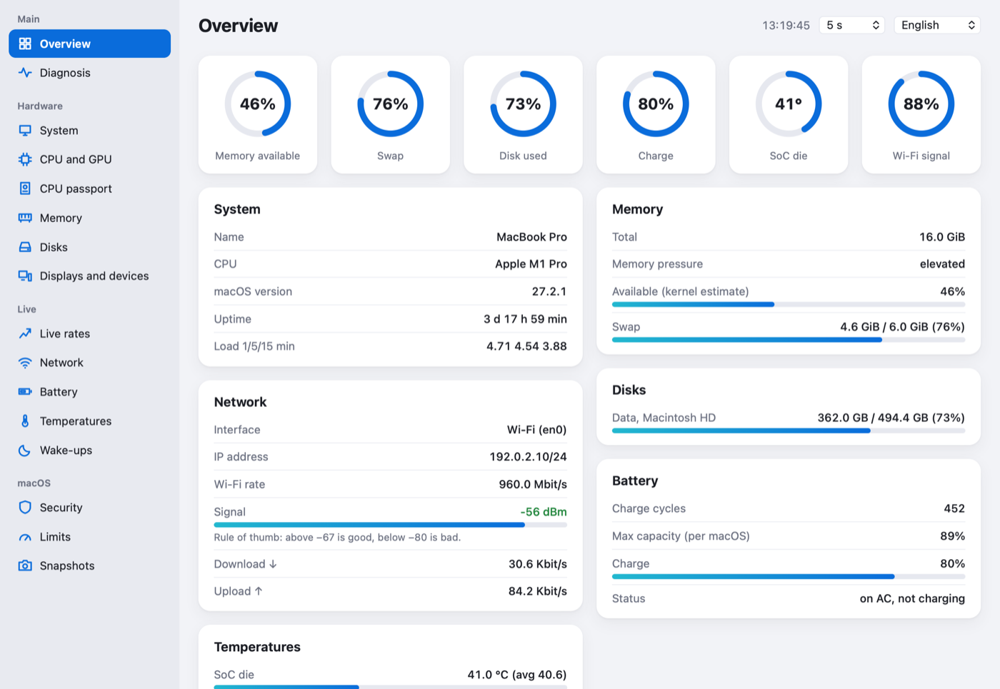

# macOSStat

English | [Українська](README.uk.md)

A native macOS system inspector in a single binary: a window, a menu bar item and a CLI.
It explains what the numbers mean instead of just listing them, needs no `sudo`, and sends nothing to the network.



## Features

- **Diagnosis**: plain-language verdicts on memory, swap, CPU, temperatures, disks, battery and charging, each with its threshold.
- **Live rates**: swap, compression, disk throughput, plus average disk writes per day.
- **Battery**: cycles, capacity, forecast, and negotiated versus actual charger power.
- **Sensors**: temperatures, fans, system power.
- **Wake-ups**: how often the Mac wakes, what requested it and how much charge it lost asleep.
- **Network**: IP, router, DNS, traffic; Wi-Fi link rate, channel, signal and noise.
- **CPU passport**: which Arm instructions are available and why they matter.
- **Snapshots**: save all kernel parameters and see what changed later.
- Hardware, disks, displays, security and limits. English and Ukrainian, light and dark themes.

## Install

Requires macOS 11 or later, Apple Silicon or Intel.

1. Download `macOSStat.tar.gz` from [Releases](https://github.com/yuriyskliarenko/macOSStat/releases).
2. Unpack and run:

```sh
tar -xzf macOSStat.tar.gz
xattr -d com.apple.quarantine macOSStat 2>/dev/null
./macOSStat
```

The binary is not notarized by Apple, so Gatekeeper blocks a copy downloaded in a browser; the `xattr` line removes that mark.
Only do this for files you trust. You can also use **System Settings → Privacy & Security → Open Anyway**.

## Usage

```sh
macOSStat                            # window and menu bar item
macOSStat --cli                      # overview
macOSStat --cli diagnosis            # any category, see --help
macOSStat --cli all --json           # everything as JSON
macOSStat --cli watch -n 1 sensors   # auto-refresh
macOSStat --cli list swap            # search all sysctl parameters
macOSStat --cli get hw.memsize vm    # keys or subtrees
macOSStat --cli snapshot save before
macOSStat --cli snapshot diff before # compare with the current state
macOSStat --cli lang uk              # save the language: en or uk
```

Closing the window keeps the app in the menu bar; quit with Cmd+Q.
The language follows the system and can be changed in the window or with `--lang en|uk` for one run.

## Data and privacy

The app only reads the system. It stores its own files in `~/Library/Application Support/macOSStat`:
battery history (one record per 12 hours while running), snapshots you save and the chosen language.
Snapshots contain your hostname and other identifiers, so think twice before sharing them.

## Limitations

- Temperatures use an undocumented Apple API; the set of sensors varies by model and macOS version and is likely empty on Intel.
- Diagnosis thresholds are rules of thumb, not Apple limits.
- The Wi-Fi name is not shown because macOS requires location access for it.

## Build

Requires Go 1.23+ and the Xcode Command Line Tools. No third-party modules.

```sh
./build.sh           # ./macOSStat for this Mac
./build.sh release   # universal dist/macOSStat and dist/macOSStat.tar.gz
./build.sh app       # optional macOSStat.app
./build.sh check     # gofmt, go vet, tests
```

Pushing a `v*` tag makes GitHub Actions publish a release.
