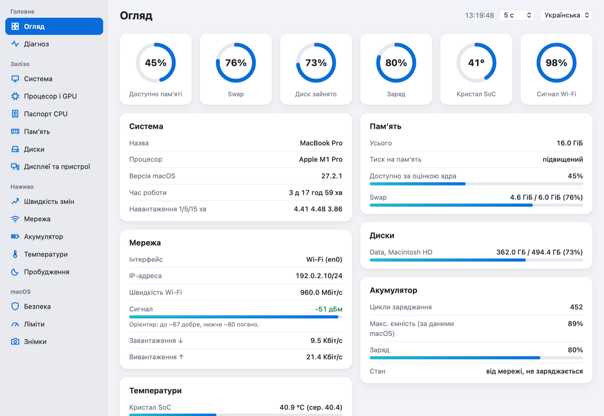

# macOSStat

[English](README.md) | Українська

Системний інспектор для macOS в одному бінарнику: вікно, іконка в menu bar і CLI.
Пояснює, що означають числа, а не лише показує їх; не потребує `sudo` й нічого не надсилає в мережу.



## Можливості

- **Діагноз**: висновки людською мовою про пам’ять, swap, процесор, температури, диски, акумулятор і зарядку, кожен із порогом.
- **Швидкість змін**: swap, стискання, швидкість дисків і середній запис на диски за добу.
- **Акумулятор**: цикли, ємність, прогноз, домовлена й реальна потужність зарядки.
- **Сенсори**: температури, вентилятори, споживання системи.
- **Пробудження**: як часто Mac прокидається, хто це замовив і скільки заряду втрачено уві сні.
- **Мережа**: IP, роутер, DNS, трафік; швидкість з’єднання Wi-Fi, канал, сигнал і шум.
- **Паспорт CPU**: які інструкції Arm доступні й навіщо вони.
- **Знімки**: зберегти всі параметри ядра й побачити, що змінилося згодом.
- Залізо, диски, дисплеї, безпека, ліміти. Українська й англійська, світла й темна теми.

## Встановлення

Потрібна macOS 11 або новіша, Apple Silicon чи Intel.

1. Завантаж `macOSStat.tar.gz` зі сторінки [Releases](https://github.com/yuriyskliarenko/macOSStat/releases).
2. Розпакуй і запусти:

```sh
tar -xzf macOSStat.tar.gz
xattr -d com.apple.quarantine macOSStat 2>/dev/null
./macOSStat
```

Бінарник не нотаризовано в Apple, тож Gatekeeper блокує копію, завантажену браузером; рядок із `xattr` знімає цю позначку.
Роби так лише з файлами, яким довіряєш. Інший спосіб: **System Settings → Privacy & Security → Open Anyway**.

## Використання

```sh
macOSStat                          # вікно та іконка в menu bar
macOSStat --cli                    # огляд
macOSStat --cli diagnosis          # будь-яка категорія, перелік у --help
macOSStat --cli all --json         # усе в JSON
macOSStat --cli watch -n 1 sensors # автооновлення
macOSStat --cli list swap          # пошук серед усіх параметрів sysctl
macOSStat --cli get hw.memsize vm  # ключі або гілки
macOSStat --cli snapshot save до
macOSStat --cli snapshot diff до   # порівняти з поточним станом
macOSStat --cli lang uk            # зберегти мову: en або uk
```

Закрите вікно лишає програму в menu bar; вихід — Cmd+Q.
Мова береться із системи; змінити її можна у вікні або на один запуск через `--lang en|uk`.

## Дані та приватність

Програма лише читає систему. Власні файли зберігає в `~/Library/Application Support/macOSStat`:
історію акумулятора (запис раз на 12 годин, поки працює), твої знімки та вибрану мову.
Знімки містять ім’я хоста та інші ідентифікатори, тож не публікуй їх бездумно.

## Обмеження

- Температури йдуть через недокументований API Apple; набір датчиків залежить від моделі й версії macOS, а на Intel, найімовірніше, порожній.
- Пороги діагнозу — орієнтири, а не межі Apple.
- Назву мережі Wi-Fi не показано: macOS вимагає для неї доступ до геолокації.

## Збірка

Потрібні Go 1.23+ і Xcode Command Line Tools. Сторонніх модулів немає.

```sh
./build.sh           # ./macOSStat для цього Mac
./build.sh release   # універсальний dist/macOSStat і dist/macOSStat.tar.gz
./build.sh app       # необов’язковий macOSStat.app
./build.sh check     # gofmt, go vet, тести
```

Пуш тега `v*` запускає GitHub Actions, який публікує реліз.
